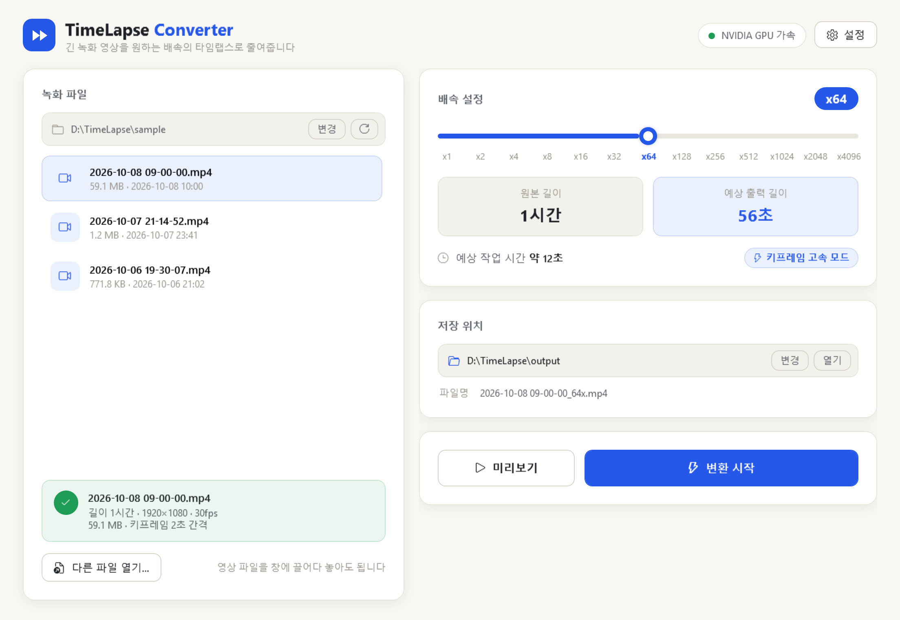

# TimeLapse Converter

몇 시간짜리 녹화 영상을 원하는 배속(x1 ~ x4096)의 짧은 타임랩스 MP4로 줄여주는 Windows 프로그램입니다.
[웹 버전(timelapse)](https://github.com/2badasea/timelapse)의 기능을 설치 없이 실행되는 exe로 옮겼습니다.



## 다운로드

**[Releases](../../releases/latest)** 에서 `TimeLapseConverter-v<버전>-win-x64.zip`을 내려받아 압축을 풀고 `TimelapseConverter.exe`를 실행하세요.
처음 실행할 때 "Windows의 PC 보호" 창이 뜨면 **추가 정보 → 실행**을 누르면 됩니다.
자세한 사용법은 zip 안의 PDF 가이드([docs/guide](docs/guide))를 참고하세요.

```
TimeLapseConverter-v1.0.0\
├── TimelapseConverter.exe             ← .NET 설치 불필요 (단일 실행 파일)
├── ffmpeg\                            ← 동봉된 FFmpeg (ffmpeg.exe, ffprobe.exe)
└── TimeLapse Converter 사용 가이드.pdf
```

- 실행 환경: Windows 10 / 11 (64비트)

- FFmpeg는 `exe 옆 ffmpeg 폴더 → PATH → C:\ffmpeg\bin` 순서로 찾고, 없으면 [설정]에서 직접 지정할 수 있습니다.
- NVIDIA 그래픽카드가 있으면 GPU(NVENC)로, 없으면 CPU(libx264)로 자동 변환합니다. GPU 변환이 실패해도 CPU로 자동 재시도합니다.

## 사용 방법

1. 왼쪽 목록에서 녹화 파일 선택 (또는 [다른 파일 열기], 창에 드래그 앤 드롭)
2. 배속 슬라이더로 배속 선택 → 예상 출력 길이 / 예상 작업 시간 확인
3. [미리보기]: 앞부분을 실제 배속으로 짧게 변환해서 바로 재생
4. [변환 시작]: 진행률·남은 시간 표시, 언제든 [작업 취소] 가능
5. 완료 후 [폴더에서 보기] / [재생]

## 기본 폴더

| 항목 | D 드라이브(고정 디스크)가 있을 때 | 없을 때 |
|------|------|------|
| 저장 폴더 | `D:\TimeLapse\output` | `C:\TimeLapse\output` |
| 임시 파일(미리보기) | `D:\TimeLapse\temp` | `C:\TimeLapse\temp` |
| 녹화 폴더 | `D:\OBS\recording` (있으면) | 내 비디오 폴더 |

[설정]에서 저장 폴더·녹화 폴더 변경, 임시 파일 정리, GPU 사용 여부, FFmpeg 위치를 바꿀 수 있습니다.
임시 파일은 앱을 종료할 때도 자동으로 정리됩니다. 설정은 `%APPDATA%\TimelapseConverter\settings.json`에 저장됩니다.

## 변환 방식 (배속에 따라 자동 선택)

웹 버전은 x128을 기준으로 두 가지 모드만 썼는데, 여기서는 영상의 키프레임 간격을 분석해 세 가지 중 가장 빠른 방식을 고릅니다.

| 모드 | 조건 | FFmpeg 핵심 옵션 | 처리 속도(1080p30, GTX 1650 실측) |
|------|------|------|------|
| 정밀 | x16 미만 | `select=not(mod(n,N)),setpts=N/FRAME_RATE/TB` | 약 25배속 |
| 고속 | x16 이상 | `-skip_frame noref -discard noref`, `setpts=PTS/N -r 30` | 약 70배속 |
| 키프레임 고속 | 배속/30 ≥ 키프레임 간격 (2초 간격이면 x64 이상) | `-skip_frame nokey -discard nokey`, `setpts=PTS/N -r 30` | 26분 영상 약 4초 |

웹 버전 대비 개선점:
- 웹 버전의 "키프레임 모드"(`noref`)는 실제로는 P-프레임까지 디코딩했음 → `nokey`로 같은 결과를 약 5배 빠르게
- 진행률: FFmpeg `out_time`은 **출력** 기준 시간이라 원본 길이로 나누면 x16에서 6%에 멈춰 있다가 100%로 튀던 문제 수정
- `ffprobe`를 PATH에서만 찾던 문제, 변환 실패해도 완료로 표시되던 문제, 중단 시 0바이트 파일이 남던 문제 수정 (`.part`에 쓰고 성공 시 이름 변경)
- 미리보기를 브라우저 재생속도(x16 한계) 대신 실제 배속으로 변환해서 보여줌

## 빌드 · 배포

.NET 8 SDK 필요. 버전은 `TimelapseConverter.csproj`의 `<Version>`에서 바꿉니다.

```powershell
.\build.ps1                       # 1) dist\ 에 exe + FFmpeg 동봉 (-FfmpegDir 로 FFmpeg 위치 지정 가능)
.\docs\guide\make-pdf.ps1         # 2) 사용 가이드 PDF (guide.html → Edge로 인쇄)
.\package.ps1                     # 3) release\TimeLapseConverter-v<버전>-win-x64.zip
```

GitHub에는 zip을 저장소 파일이 아닌 **Releases 첨부 파일**로 올립니다 (git은 파일당 100MB 제한, 릴리스 첨부는 2GB까지).
릴리스 설명은 `release\RELEASE_NOTES_v1.0.0.md`를 붙여 넣으면 됩니다.

### 가이드 화면 캡처

`TimelapseConverter.exe --snapshot <폴더> [--source <녹화폴더>] [--file <영상>] [--convert <배속단계0~12> <저장폴더>]`
→ 시작/메인/드래그/진행/완료/미리보기/설정 화면을 2배 해상도 PNG로 저장하고 종료합니다 (설정 파일은 건드리지 않음).
v1.0.0 가이드 이미지는 개인 화면이 나오지 않도록 FFmpeg로 만든 1시간짜리 "샘플 녹화 영상"(시계 화면)으로 캡처했습니다.

## 구조

```
App.xaml(.cs)              앱 시작/종료 (임시 파일 정리)
MainWindow.xaml(.cs)       메인 화면
PreviewWindow.xaml(.cs)    미리보기 재생 창
SettingsWindow.xaml(.cs)   설정 창
Themes/Porcelain.xaml      색상(#F8F7F4 + 로열 블루)·컨트롤 스타일
Services/FfmpegTools.cs    FFmpeg 탐색·영상 분석·변환 (GPU→CPU 자동 재시도)
Services/TimelapsePlanner.cs  배속별 모드 선택, 예상 시간 계산
Services/AppSettings.cs    설정 저장/불러오기
Services/ChildProcessGuard.cs 앱이 강제 종료돼도 FFmpeg가 남지 않게 (Job Object)
```

## 라이선스

이 프로그램의 소스 코드는 [MIT License](LICENSE)를 따릅니다.

릴리스 zip에 함께 들어 있는 [FFmpeg](https://ffmpeg.org)(BtbN GPL 빌드)는 별도 프로그램으로, GPL 라이선스를 따릅니다.
라이선스 전문은 zip 안의 `ffmpeg\FFmpeg-LICENSE.txt`에 있으며, 소스와 빌드는 [FFmpeg](https://ffmpeg.org/download.html) · [BtbN/FFmpeg-Builds](https://github.com/BtbN/FFmpeg-Builds)에서 받을 수 있습니다.
